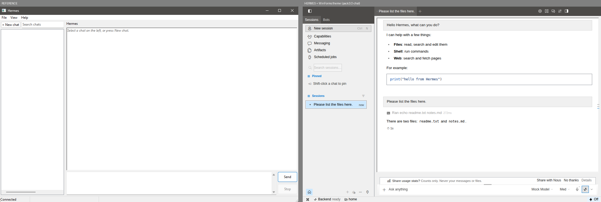

# HA Themes for Hermes Desktop

A small **theme pack** for [Hermes Agent](https://github.com/NousResearch/hermes-agent)'s Desktop app.
Installing it adds these themes to **Settings → Appearance**. Nothing changes until you pick one.

| Theme | Name | Look |
|---|---|---|
| **WinForms** | `winforms` | A plain native Windows 10 utility: charcoal title bar, grey control face, white list and transcript panes with sunken edges, Segoe UI, square corners, no shadows or blur |
| **Badi Dark (Desktop)** | `badi-dark-desktop` | Deep charcoal with a soft blue accent |



Both themes are built the way the Hermes docs define a Desktop theme: a theme-only Desktop plugin that
registers `DesktopTheme`s through the plugin SDK (`THEMES_AREA`). It makes no network calls and
registers no agent tools, hooks or settings. See [`CONFORMANCE.md`](CONFORMANCE.md) for the
rule-by-rule check against the Hermes documentation.

## Install

The pack is one file. Put it in the Desktop plugins folder of each computer where you use Hermes
Desktop. This is the Hermes docs' recommended "disk" delivery, and it works whether the app runs its
own backend or connects to a remote one.

macOS / Linux:

```bash
mkdir -p ~/.hermes/desktop-plugins/ha-themes && \
curl -fsSL https://raw.githubusercontent.com/badiyee85/HA-Themes/v0.3.0/desktop/plugin.js \
  -o ~/.hermes/desktop-plugins/ha-themes/plugin.js
```

Windows (PowerShell):

```powershell
$d = "$env:LOCALAPPDATA\hermes\desktop-plugins\ha-themes"; New-Item -ItemType Directory -Force $d | Out-Null
Invoke-WebRequest https://raw.githubusercontent.com/badiyee85/HA-Themes/v0.3.0/desktop/plugin.js -OutFile "$d\plugin.js"
```

The app picks it up within seconds (or ⌘K / Ctrl+K → **Reload desktop plugins**). If you use a custom
`HERMES_HOME`, use `<HERMES_HOME>/desktop-plugins/ha-themes/` instead.

## Use

- **Settings → Appearance** → pick **WinForms** or **Badi Dark (Desktop)**, or type `/skin winforms` /
  `/skin badi-dark-desktop` in a Desktop chat. Your pick is remembered.
- Go back the same way, e.g. `/skin nous`.
- For WinForms' flat look, keep translucency off (Settings → Appearance).

## Update / remove

- **Update:** run the install lines again with the newer tag (see [Releases](https://github.com/badiyee85/HA-Themes/releases)).
- **Remove:** delete the `ha-themes` folder. The app falls back to its default theme.

The repo is also a valid Hermes plugin package (`plugin.yaml`, `desktop/plugin.js`, inert `__init__.py`).
`hermes plugins validate .` passes. Installing it with `hermes plugins install` is not the supported
route yet: in our tests on Hermes 0.22.5 the package's Desktop half did not show up in the app.

## Requirements and notes

- Hermes **0.22.2 or newer** (the hooks are checked against that release; real-app tests run on 0.22.5).
- Segoe UI ships with Windows only. On macOS and Linux, WinForms falls back to Helvetica Neue,
  Arial or Liberation Sans.
- WinForms is **unofficial and not affiliated with Microsoft**; it imitates a generic Windows look.
- A future Hermes release can rename the screen elements a theme styles. Parts of the look would
  then fall back to the plain palette; nothing breaks.

## Develop

| Path | What |
|---|---|
| `themes/<name>/theme.json` | a theme's name, label, colours (all `DesktopThemeColors` keys) and typography |
| `themes/<name>/theme.css` | optional `customCSS`, every selector scoped to `:root[data-hermes-theme='<name>']` |
| `desktop/plugin.js` | the built plugin (`python3 tools/build.py`); do not edit by hand |
| `plugin.yaml`, `__init__.py` | package manifest; inert Agent entrypoint |
| `tools/test_theme.py` | conformance + contract tests (`HERMES_SRC=<hermes checkout>` selects the build) |
| `tools/shoot.sh` | real-app tests: installs the built pack into an isolated Desktop under Xvfb |
| `docs/shots/` | screenshots and measurements for the current version |

```bash
python3 tools/build.py
python3 tools/test_theme.py      # with a Python that can import hermes_cli
hermes plugins validate .
tools/shoot.sh <label>           # needs a built Hermes Desktop checkout and xvfb-run
```

To add a theme, create `themes/<name>/theme.json` (and optionally `theme.css`), add it to
`test_pack_contains_the_expected_themes`, build, and run the checks.

MIT licensed.
